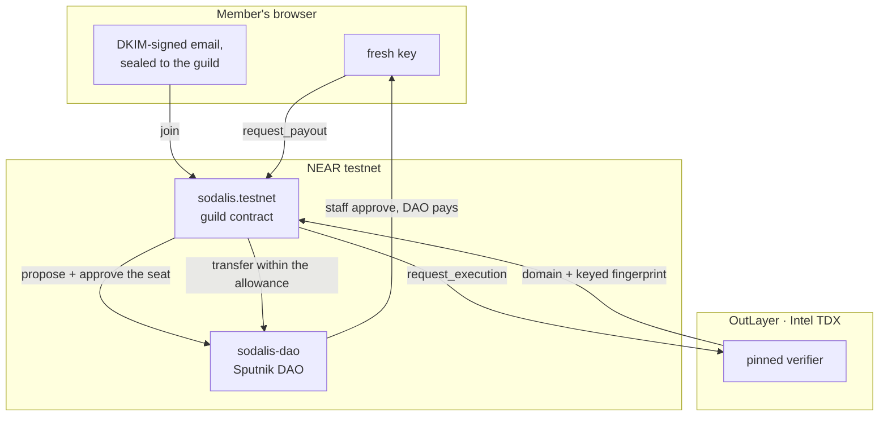

# Sodalis

**Prove you belong. Never say who you are.**

> *An illustration.* Maya's car breaks down three days before payday. Her team keeps a small fund for exactly this. But asking means telling the colleagues who run it that she's short this month. So she doesn't ask.

**Sodalis is a team fund on NEAR that a member can ask for help without their email address ever being published.** A member proves they belong with an email from an approved domain. The email is opened only inside an attested enclave; the public record holds a domain and a keyed fingerprint, never the address. One mailbox earns one seat in a Sputnik DAO treasury, and money moves in rounds the chain enforces: a budget per round, an allowance per seat, a steward's approval. When a member leaves, their access ends.

OutLayer verifies private eligibility: without it there is no private admission and no seat. The guild contract enforces each round's limits. Sputnik governs membership and executes approved transfers: without it there is no vote and no payment.

| | |
|---|---|
| **Live** | https://sodalis-red.vercel.app |
| **Follow one member** | [/case](https://sodalis-red.vercel.app/case/): a first-time user from email to payment, and a member from first seat to departure, every step re-checked in your browser |
| **Paid** | A member asked round 1 for 0.05 NEAR; staff approved; the DAO paid exactly 0.05 · [`qLiFNjgb…`](https://testnet.nearblocks.io/txns/qLiFNjgbnNbh9sCu9HV1JG16ZgfjxzNWkhA13kKZkzd) |
| **Refused** | The same seat asked for 0.06 more: `exceeds your allowance in this round` · [`GZkwDr3b…`](https://testnet.nearblocks.io/txns/GZkwDr3bSTsR5QP3Cz8AKCbVbQjrRNvehojsxwnVv4ab) |
| **Refused** | A member left, lost its DAO seat in the same transaction, and asked again: `only seated members may request a payout` · [`B4JU3VFS…`](https://testnet.nearblocks.io/txns/B4JU3VFSzRg6mbyHRKqfqC61yrRmruuB4XCmAEGJxwj2) |
| **Demo video** | Recording; linked at submission |
| **Tracks** | **Social Money**: a DAO treasury whose eligibility, allowance and departure rules the chain enforces. **Privacy & Private AI**: confidential computation in an OutLayer TEE (Intel TDX) decides who belongs. |

> **Status.** Live on NEAR testnet with real emails (Proton, Gmail, and a custom domain on Hostinger). Each outcome in the table above is a linked testnet transaction, and a first-time user has joined and been paid. The steward and the council are the builder's accounts; a pilot with a real team fund is next. Everything else that is partial or missing is in [What is real](#what-is-real).

    

## Judge it in 90 seconds

No wallet, key or funds are needed for any of this.

| Do | See |
|---|---|
| Open [/case](https://sodalis-red.vercel.app/case/?case=first-user) | A first-time user's admission, request, approval and transfer, each verified live. The [departure case](https://sodalis-red.vercel.app/case/?case=departure) adds two refusals and loss of the seat |
| Open [/proof](https://sodalis-red.vercel.app/proof/) | Four recorded admissions and both rounds re-verified from NEAR testnet, OutLayer's attestation API and Intel's collateral. Press **Forge one byte** and the ledger turns red |
| Open [/judges](https://sodalis-red.vercel.app/judges/) | Thirteen real attacks on the live guild, each re-read from chain with its refusal |
| Open [/join](https://sodalis-red.vercel.app/join/) | The member flow itself. Using it creates and funds a real testnet key and sends transactions; viewing it does not. About ten minutes, with a Gmail or Proton and a second inbox |
| Run `npm test` | 28 tests: 23 re-read the admissions, refusals and payouts below from testnet, 5 check sealing offline |

## How it works



**One mechanism: a sealed letter opened only inside an attested enclave.**

1. The page makes a fresh key and a challenge subject, `sha256(guild:wallet:salt)` plus an expiry, that points at the key without saying so.
2. The member emails that subject from their mailbox to a second inbox; their mail host signs it with DKIM.
3. The browser drops the unsigned headers and seals the email to the guild's inbox key.
4. `join` asks OutLayer to run the verifier build the guild pins. Inside Intel TDX it checks the signature, the domain, the subject's binding to this wallet and guild, and the expiry, then returns the domain and an HMAC of the mailbox under a secret no one has seen.
5. In the same transaction the guild refuses a fingerprint it has already admitted, records the member, and seats it in the DAO role for that domain's tier.

The fingerprint admits one wallet per admission epoch: one seat per mailbox, not per person. An organisation domain proves membership of that organisation and can seat `staff`, who approve payouts. Free mail (Gmail, Proton) proves only control of one mailbox, so it reaches only `public`, which can ask but not approve.

**Rounds.** The DAO opens a round with a budget and the same allowance for every seat. A member asks the guild (`request_payout`) with an amount and a fixed category; there is no free-text field. The guild refuses anything past the seat's allowance or the round's budget, reserves the amount and files the DAO transfer itself. The DAO's policy lets members file transfers only through the guild, so a member cannot skip a round (the council, which governs the DAO, still can). Staff decide. Anyone can `settle` a decided request: it is booked as approved, or its reservation returns to the round if the DAO rejected, expired or removed it. **Leaving** (or being revoked) removes the DAO seat in the same transaction, and the guild refuses that account's next request.

## Verify it yourself

```bash
git clone https://github.com/Cassxbt/sodalis && cd sodalis && npm ci

npm test               # 28 tests: 23 re-read admissions, refusals and payouts from testnet; 5 check sealing offline
npm run verify:build   # rebuilds the verifier and the guild contract; checks both against the chain
npm run test:contract  # 56 contract tests (Rust, offline)
npm run test:verifier  # 43 verifier checks (offline): 34 signed-email cases of DKIM attacks and edge cases, plus 9 enclave-environment checks
```

`npm run verify:build` exits non-zero if the source and the chain disagree. Expected output:

```
verifier (runs in the enclave)
  rebuilt from source    9c0ef7f327e5eebb38540f15ea773c70dc63977b267bdb0d28c696ca5aad291f
  pinned by sodalis.testnet  9c0ef7f327e5eebb38540f15ea773c70dc63977b267bdb0d28c696ca5aad291f
  served by FastFS       9c0ef7f327e5eebb38540f15ea773c70dc63977b267bdb0d28c696ca5aad291f
guild contract
  rebuilt from source    B8EywgDtj7UaXmYNDknso8bZAKNjavRwi7geULrG9kak
  deployed at sodalis.testnet B8EywgDtj7UaXmYNDknso8bZAKNjavRwi7geULrG9kak
MATCH: the guild runs exactly this source, on chain and in the enclave.
```

Requirements: Node 22+ and Rust; the toolchain is pinned to 1.99.1 in `rust-toolchain.toml`, with the `wasm32-wasip1` and `wasm32-unknown-unknown` targets. The live tests need network access; history is read from two independent archive nodes, with the regular node first.

## Why NEAR

Remove any of the first four and the mechanism stops working; the last two support it:

| Primitive | Its job in Sodalis | Where |
|---|---|---|
| **OutLayer** `request_execution` with yield/resume | The contract calls the enclave and acts on its answer in the same transaction. No backend sits between proof and seat. | `contract/src/lib.rs` (`join`, `on_verified`) |
| **OutLayer** keystore: WasmHash-bound secrets with a `Predecessor` rule | The guild master is generated inside the keystore, released only to one verifier build, only on runs the guild requests, and owned by the guild account. | `scripts/7_rekey.mjs`, `verifier/src/main.rs` |
| **OutLayer** per-execution TDX attestation | Anyone can check that the enclave ran this code on this input and produced this output. | `web/src/attest.js` |
| **Sputnik DAO** roles, policy and transfers | Tiers are DAO roles. The guild holds a `gatekeeper` role that adds and removes seats and files round transfers; only staff or the council approve one, and the DAO pays. Deployed from the `sputnik-v2.testnet` factory. | `contract/src/round.rs`, `scripts/10_rounds.mjs` |
| **FastFS** | Serves the verifier by content hash, so the guild pins code, not a URL. | `scripts/6_migrate.mjs` |
| **NEP-366** meta-transactions | The member is whoever calls `join`, not whoever pays gas, so a relayer could sponsor a new wallet. Unit-tested with a caller different from the signer; not exercised live, where the Join page funds new keys with a visible drip instead. | `contract/src/tests.rs` |

## Evidence: allowed and refused

Guild `sodalis.testnet` · DAO `sodalis-dao.sputnik-v2.testnet`. Every row is re-checked by `npm test` and on the site. The full history, including three earlier versions and why each changed, is in [RECEIPTS.md](RECEIPTS.md).

**Admission**

| What happened | Result | Tx |
|---|---|---|
| A real email from a custom domain (`d=trendtwin.xyz`) joins | Seated as **staff** | [`AkSAiijE…`](https://testnet.nearblocks.io/txns/AkSAiijEq17NBYu1Heh82hU8uEXpR5t2quhBhXefqYUk) |
| A real Proton email (`d=proton.me`) joins | Seated as **public** | [`B4aqUCYV…`](https://testnet.nearblocks.io/txns/B4aqUCYVAytpX6Tv25YcFQhNc7UMSedmb5YED6CRifkL) |
| A first-time user joins from their own tablet with a Gmail-signed email | Seated as **public**; 12 of 12 checks passed in their browser | [`9hJoh9YG…`](https://testnet.nearblocks.io/txns/9hJoh9YGNR8ZZ59pExrGoDW5qP37ZepcpUxJUwBU3fGe) |
| The same mailbox signs a fresh, valid challenge for a second wallet | **Refused**: `this email address already admitted a member` | [`FdBzomLr…`](https://testnet.nearblocks.io/txns/FdBzomLry7UaV3jLiNdVFJPUKVcjNgqZS38aYQonPWio) |
| Another wallet replays a member's sealed email | **Refused**: `challenge is bound to a different wallet or guild` | [`9Xtf5tXu…`](https://testnet.nearblocks.io/txns/9Xtf5tXumh1jyaPvJ45Dk93QcQufiEfYFbM6T7AZStLC) |
| An outside account calls OutLayer with the guild's secret | **Refused** by the keystore: `Access denied by access condition` | [`2R1cfdGX…`](https://testnet.nearblocks.io/txns/2R1cfdGXAFoPRNTMLLtsTA2QaJji7j8oJ9vzvgH44NpW) |

**Money**

| What happened | Result | Tx |
|---|---|---|
| Round 1 (0.5 NEAR, 0.1 per seat): a public member asks for 0.05; staff approve | The DAO pays exactly 0.05; the round books it | [`Euo7rGtk…`](https://testnet.nearblocks.io/txns/Euo7rGtkxqSQ2VMWHEbQntjEM5FvhriGXNcdA4e6yJY9) · [`qLiFNjgb…`](https://testnet.nearblocks.io/txns/qLiFNjgbnNbh9sCu9HV1JG16ZgfjxzNWkhA13kKZkzd) · [`GFFV57cM…`](https://testnet.nearblocks.io/txns/GFFV57cMe8FZ6qFBPCodRYCTqz1NA8uAnCjq1ctgAcft) |
| The same seat asks for 0.06 more | **Refused**: `exceeds your allowance in this round` | [`GZkwDr3b…`](https://testnet.nearblocks.io/txns/GZkwDr3bSTsR5QP3Cz8AKCbVbQjrRNvehojsxwnVv4ab) |
| It files a transfer straight with the DAO | **Refused** by the DAO policy: `ERR_PERMISSION_DENIED` | [`BcBnvJMu…`](https://testnet.nearblocks.io/txns/BcBnvJMu78hz64jS7C4CM92bCHeDpLvxjkp5V3P9VYPf) |
| Round 2 (0.15 NEAR, 0.1 per seat): a staff seat with its whole allowance left asks for 0.06 when the pot has 0.05 | **Refused**: `exceeds the round's remaining budget` | [`5nuDd6fU…`](https://testnet.nearblocks.io/txns/5nuDd6fUrj9bmavkJxahT7wfk5iTH4EAgP3kbZrFfSt2) |
| Staff reject a 0.1 request; anyone settles it; someone settles it again | Returned to the round once; the second settle is **refused**: `this request is already settled` | [`STY4fGnh…`](https://testnet.nearblocks.io/txns/STY4fGnhYdaMkCTBjRzJ5wqMWvdHhdshnpkhDDqr9Bq) · [`7hzcL4Qr…`](https://testnet.nearblocks.io/txns/7hzcL4Qr8gUaYhmWDiVGj9a3zuUiQGsyiF65yBedFBeE) · [`BZz83MP8…`](https://testnet.nearblocks.io/txns/BZz83MP86L1pCGxHTbZsDpgC8NvdG32JUWEHLVU2u2xX) |
| The first-time user asks round 2 for 0.05 for travel; a steward approves | The DAO pays exactly 0.05; the round books it | [`8UcMF6Pq…`](https://testnet.nearblocks.io/txns/8UcMF6PqYaWNmzB4oh3Uwkr4t7wGnRLnffuiHWar95uC) · [`8MW1nWsL…`](https://testnet.nearblocks.io/txns/8MW1nWsLU6tY5bcJ6d3EuVLkCxZP69mnAJs8FxFUxqb3) · [`8Er7qb6E…`](https://testnet.nearblocks.io/txns/8Er7qb6E5niGp4nvX5QJzAa3r7UaRbpDSHf2v8DynboB) |

**Governance**

| What happened | Result | Tx |
|---|---|---|
| A member leaves | Its DAO seat is removed in the same transaction | [`CmKnfQ1C…`](https://testnet.nearblocks.io/txns/CmKnfQ1CKk16ZK5zKiKA1szYLTEh8HSkZXx7e5TQxuDD) |
| It asks for a payout again | **Refused**: `only seated members may request a payout` | [`B4JU3VFS…`](https://testnet.nearblocks.io/txns/B4JU3VFSzRg6mbyHRKqfqC61yrRmruuB4XCmAEGJxwj2) |
| An outside account calls the guild's one-time `reset` | **Refused**: `Method reset is private` | [`DP9VHiGR…`](https://testnet.nearblocks.io/txns/DP9VHiGRGerz8G6HNpnqY2GHggQXpZhfRp85wsGDKj6k) |
| The former owner pins a DKIM key after handing the guild to the DAO | **Refused**: `owner only` | [`FvyF4rdu…`](https://testnet.nearblocks.io/txns/FvyF4rdu6NweHTG5VPQi4SuXX8aaUQh2eRWWriCfxCa1) |

### What the attestation check proves

For each admission, [`web/src/attest.js`](web/src/attest.js) runs twelve checks from public data only:

1. Intel signed the TDX quote; the DCAP chain and TCB status are `UpToDate`.
2. The worker's measurements are on OutLayer's approved list (`worker.outlayer.testnet`).
3. The quote's `report_data` equals the task hash recomputed from the attestation fields.
4. The quote's signed block height and caller match the request OutLayer recorded on chain.
5. The guild itself requested the run.
6. The code that ran is the verifier the guild requested in that transaction, so old proofs survive upgrades.
7. It ran on the input recorded on chain.
8. The guild acted on exactly the output the enclave produced.
9. The guild admitted the wallet the verifier checked.
10. It recorded the nullifier the verifier derived.
11. The guild proposed exactly that seat.
12. The DAO approved it.

A check that cannot run says *not verified here*; it never counts as a pass.

## What a member reveals

| Step on [/join](https://sodalis-red.vercel.app/join/) | Public on testnet | Seen by |
|---|---|---|
| Fund the key | That the guild drip funded this key, and when | The site's host sees the visitor's IP address |
| Send the challenge | Nothing | The member's mail provider and the inbox it was sent to |
| Join | The key, the domain, a keyed fingerprint of the address, the sealed bytes, the tier and the time | Only the enclave opens the email |
| Ask the treasury | The amount, a fixed category and every vote | Everyone; the page shows the exact public text before filing |

## Trust model

| Party | Could | Stopped by |
|---|---|---|
| A member's mail host | Sign mail for any address on its domain | Nothing. DKIM trusts the domain's mail host, as email does. |
| OutLayer operator | Withhold or delay a run | It cannot forge one with an approved image: the quote binds code, input and output. |
| OutLayer's register owner | Approve a malicious worker image | The approved list is public and the proof page shows which image ran. **This is the deepest trust assumption.** |
| DAO council (the builder) | Change domains and policy, open rounds, file or approve a transfer outside a round | Every change is a public DAO proposal. Round limits bind members, not the council that governs the DAO. |
| Builder | Redeploy the guild while its account holds a key | Disclosed here. The key is kept until a failed seat removal and its repair are rehearsed on chain; departure already is. |
| Chain readers | See the domain, the wallet and a fingerprint | The fingerprint is keyed by a master that never leaves the enclave, so a guessed address cannot be tested against it. |

## What is real

| Claim | State |
|---|---|
| A real DKIM email from an approved domain earns a DAO seat; one mailbox, one seat | **On chain** (Sybil attempt refused) |
| The enclave run is attested and bound to code, input and output | **On chain**, checked in the browser |
| Public members only ask; staff approve (the council can too) | **On chain** |
| Per-seat allowance and round budget | **On chain**: one refusal past the allowance, one past the budget, and a DAO bypass refused |
| Leaving ends spending authority | **On chain, one recorded case**: after leaving, the member's next request was refused |
| A rejected request returns to the round, once | **On chain**. An undecided request stays reserved until the DAO records an outcome; one that ends `Failed` stays reserved |
| A brand-new member can join from a browser with no wallet | **On chain**, twice: once by the builder, once by a first-time user |
| Someone outside the builder completes the flow | **Done once, with a guide**: a first-time user the builder reached out to joined and was paid, following an eight-step written guide and no other help. They found the page alone confusing; the guide is now on the page |
| Who runs this deployment | **Demo setup**: the steward and the council are the builder's accounts |
| A filing whose callback never records a proposal id | **Not handled**: the amount stays reserved with no record to reconcile; this has not occurred, and the guild key is kept partly for this repair |
| A real team or community running its own fund | **Next**: a pilot with an existing team fund |
| A staff member cannot approve their own request | **Not provided**: Sputnik cannot tell the receiver from the voter, and this guild has one staff member. With several staff, require two approvals |
| A member's wallet cannot be linked to their email | **Designed**: the chain holds a domain and a keyed fingerprint; a /join member's key is fresh, though the drip's funding is public. The builder's test seats are named subaccounts and are linked to the builder |
| A relayer can pay gas for a brand-new wallet | **In tests**; the live Join page uses a visible drip |
| Guild key deleted, issuer list sealed | **Not done**, on purpose: a failed seat removal and its repair are rehearsed first, and sealing would block a mail provider's key rotation |
| Forward secrecy; seat recovery after a lost key | **Not provided**: sealed letters stay on chain, and a spent mailbox cannot rejoin |
| OutLayer testnet availability | **Observed outages**: some runs got no answer within 200 blocks. The contract refunds and admits no one; a retry worked each time |

Lessons that shaped the design are recorded in [RECEIPTS.md](RECEIPTS.md): Gmail does not DKIM-sign mail to the same address, so the challenge goes to a second inbox; OutLayer lets a secret's owner replace it, so the guild owns its own secret; a reset must not reuse storage prefixes; and settling must wait for outcomes the DAO has recorded.

## Project layout

```
contract/   guild contract (near-sdk 5.29.1): join, tiers, DAO seating, payout rounds; 56 tests
verifier/   enclave program (Rust → wasm32-wasip1): DKIM, sealing, nullifier
web/        the site: Vite multi-page; every check runs in the browser
api/        the guild drip (a Vercel function that funds new keys with test NEAR)
test/       npm test: live checks against testnet plus offline sealing checks
fixtures/   34 signed test emails made with a throwaway DKIM key and cross-checked with dkimpy; never trusted on chain
scripts/    the deploy, upgrade and evidence scripts that created the testnet state (need the builder's keys)
```

## Built with

- **Rust:** `near-sdk`, `rsa`, `sha2`, `hmac`, `hkdf`, `x25519-dalek`, `chacha20poly1305`, `base64`, `serde`.
- **JS:** `near-api-js`, `@noble/curves`, `@noble/ciphers`, `@noble/hashes`, `@phala/dcap-qvl` 0.7.0 (Intel DCAP verification; patched for GHSA-796p-j2gh-9m2q), `vite`.
- **Python (fixtures only):** `dkimpy`.

## Hackathon

Built at **NEAR HACKATHON** by **cassxbt** for the **Social Money** and **Privacy & Private AI** tracks. All code was written during the hackathon window, from 2026-10-19.

MIT licensed, see [LICENSE](LICENSE).
